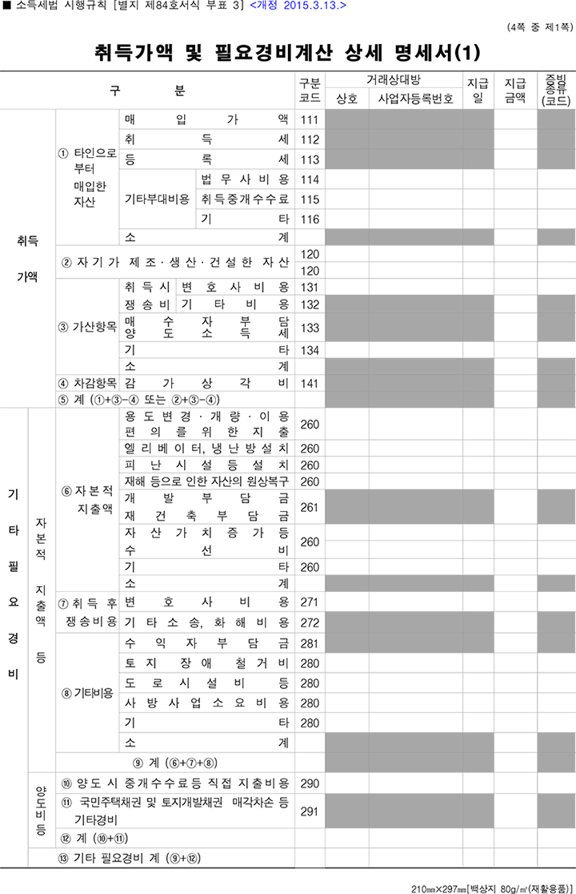

양도소득의 필요경비 계산은 [소득세법 제97조](https://www.law.go.kr/법령/소득세법/제97조)에 명시되어 있습니다. 크게 세가지 카테고리로 나누어집니다. (참고로 소득세법은 2022년 12월 31일에 개정되었지만 제97조는 바뀌지 않았고, 2023년 7월 18일에 제정된 「가상자산 이용자 보호 등에 관한 법률」(2024년 7월 19일 시행)이 도입을 목전에 두고 있습니다. 가상자산 이용자 보호에 대한 내용이 추가됩니다.)

1\. 취득가액(실지거래가액, 매매사례가액, 감정가액, 환산취득가액 순서로 계산)

2\. 자본적지출액

3\. 양도비

그럼 각각의 항목에 어떤 요소가 포함될까요? 이건 국세청 양도소득세 신고가이드를 보면 알 수 있습니다.

{: width="720" height="1116" }
_출처: 국세청 상세 명세서 (https://www.nts.go.kr/tax/sub/1.2.1.취득가액 및 필요경비계산 상세 명세서.html)_

첫 항목인 취득가액 부터 보시면 되겠습니다. 취득가액에는 매입가액, 취득세, 등록세, 기타부대비용(법무사비용, 취득중개수수료)등이 있습니다. 내리다보면 취득시쟁송비도 있는데, 이는 [소득세법 시행령 제163조(양도자산의 필요경비)](https://www.law.go.kr/LSW//lsLinkCommonInfo.do?lspttninfSeq=126539&chrClsCd=010202)에도 나와있습니다.

\" 취득에 관한 쟁송이 있는 자산에 대하여 그 소유권 등을 확보하기 위하여 직접 소요된 소송비용ㆍ화해비용 등의 금액으로서 그 지출한 연도의 각 소득금액의 계산에 있어서 필요경비에 산입된 것을 제외한 금액\"

자본적 지출액에는 용도변경, 엘리베이터/냉난방 설치 등이 있습니다. 양도비에는 양도시 중개수수료 등 직접 지출비용이 있습니다.

생각해보면 매우 직관적입니다. 내가 실제로 얻은 소득에 세금을 부과하는 것이 합리적입니다.

자세한 등기비용과 관계해서는 아래 사이트를 참조하시면 좋습니다.

[https://xn-\-989a00af8jnslv3dba.com/%EB%93%B1%EA%B8%B0%EB%B9%84%EC%9A%A9](https://xn--989a00af8jnslv3dba.com/%EB%93%B1%EA%B8%B0%EB%B9%84%EC%9A%A9)

> **[부동산계산기](https://xn--989a00af8jnslv3dba.com/%EB%93%B1%EA%B8%B0%EB%B9%84%EC%9A%A9)**  
> 부동산계산기 DTI DSR LTV 등기수수료 법무사수수료 공인중개사 중개수수료 종합부동산세 재산세 양도소득세 공동명의 임대수익률 대출가능액  
> <small>xn-\-989a00af8jnslv3dba.com</small>
