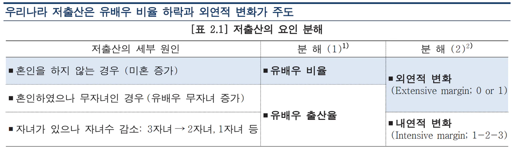
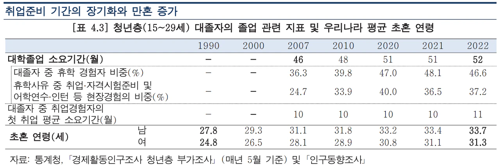
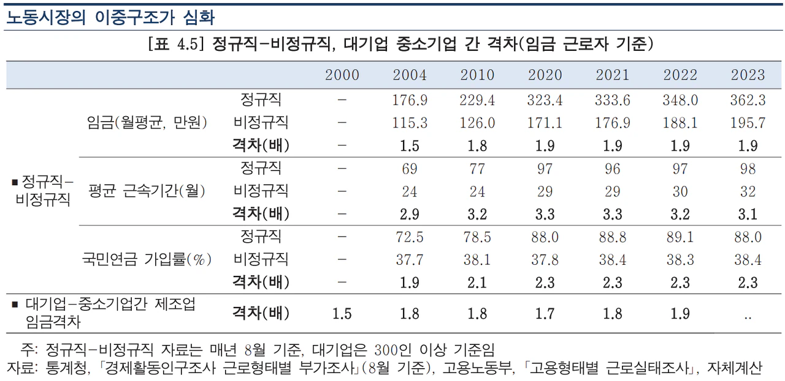
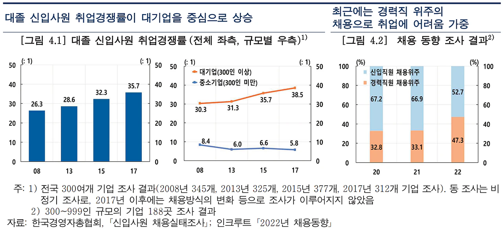
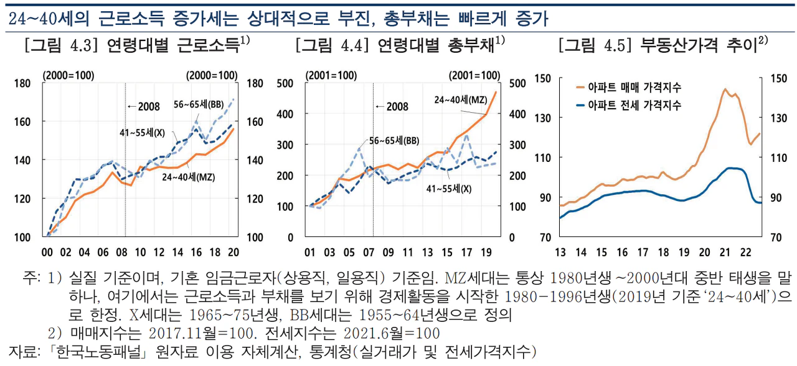
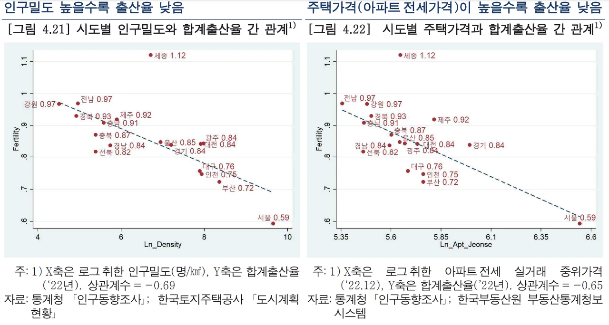

The paper published by the Bank of Korea on \"[Super-aged society and super-low birth rate](https://www.bok.or.kr/portal/bbs/P0002359/view.do?nttId=10080881&menuNo=200066&pageIndex=1)\" addresses the critical issue of aging and declining birth rates in Korea, along with potential solutions. The super-aged society results from the extremely low birth rate, which is primarily driven by three factors:

{: width="1280" height="373" }

1\. Delayed Marriages

The age of marriage is increasing due to the widening income gap between major companies and others. This gap leads to extended education periods and, consequently, a shorter window for childbirth, reducing the overall birth rate.

{: width="800" height="429" }

{: width="800" height="623" }

{: width="800" height="585" }

2\. Economic Burden on Youth

Income growth for the younger generation is sluggish compared to older populations. Meanwhile, youth debt and housing costs are surging, creating a challenging environment for starting families.

{: width="800" height="590" }

3\. Cost and Expectations of Weddings

The cultural expectation in Korea is to have children post-marriage, unlike some Western nations like France, where more than half of the children are born to parents who aren\'t legally married. The expense and expectations surrounding weddings add another barrier.

The density-fertility plot provides further evidence of this trend: cities with higher population densities, which are typically more competitive, have lower fertility rates. Seoul, for instance, has the lowest fertility rate in Korea.

{: width="800" height="684" }

To address these issues, the following solutions are proposed:

1\. Reducing Urban Centralization: Decentralizing the population from urban centers to balance regional development.

2\. Enhancing Parental Leave Usability: Encouraging the actual use of parental leave to support family planning.

3\. Stabilizing the Housing Market: Making housing more affordable to ease the financial burden on young families.

4\. Reducing Income Disparity: Bridging the gap between large corporations and smaller businesses to create a more equitable economic landscape.

However, our perspective must be changed to break this status quo, which is a real challenge. Here are the questions we can discuss: Let us assume we are moving to Gwangju, Daegu, or Busan.

1\. What is the condition in which you would prefer to live in those places? (Income, housing, natural landscape, etc.)

2\. What would be the most critical aspect that has to be added to living in those cities? (Education, medical facilities, etc.)

3\. How can we free ourselves from uniform value standards?
