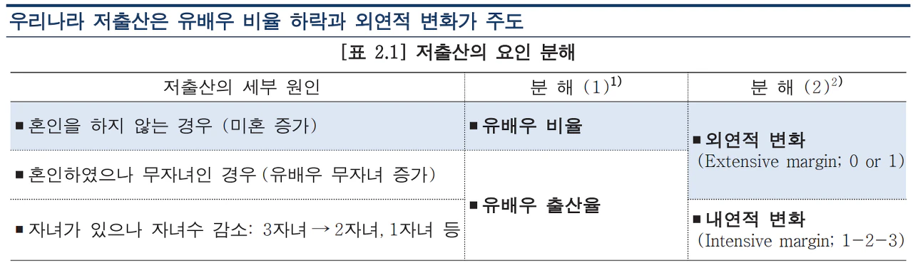
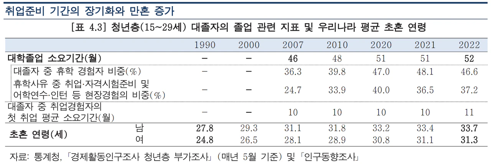
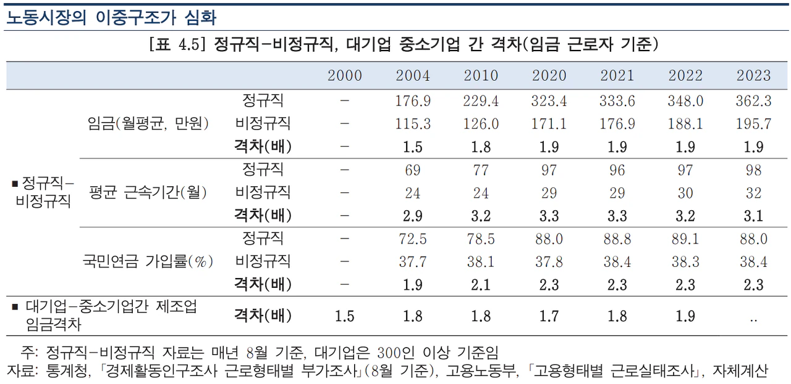
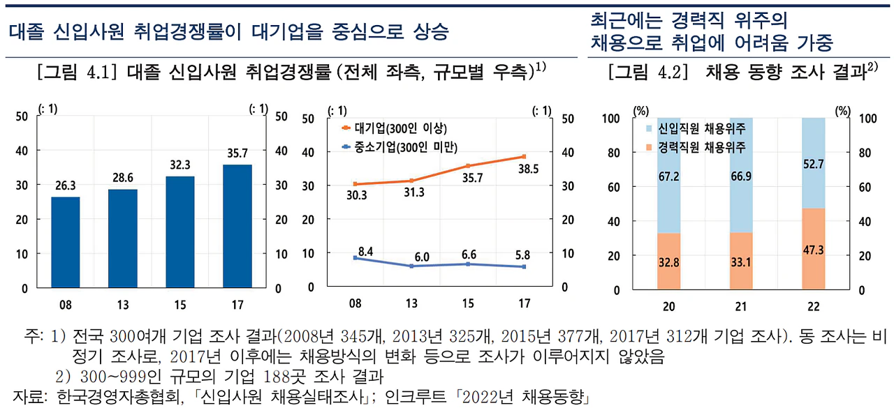
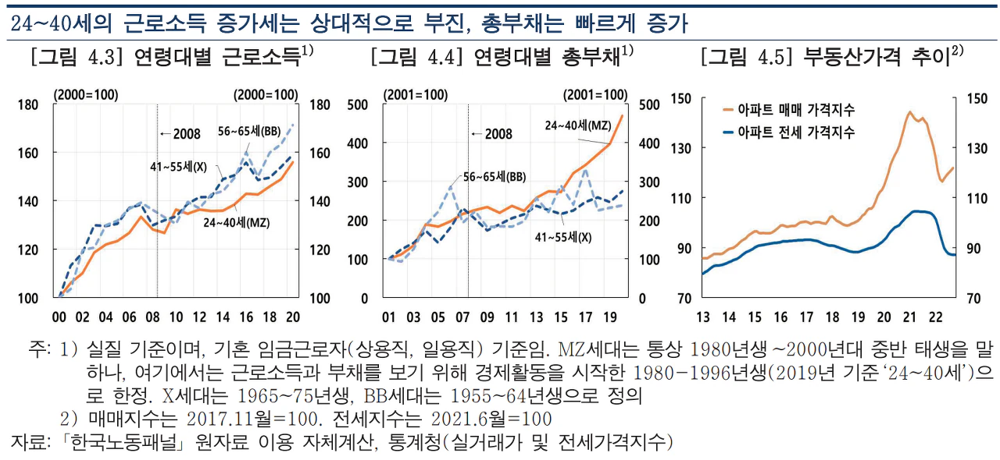
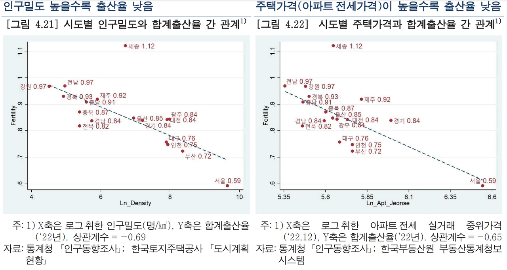

한국은행이 발표한 [초고령 사회와 초저출산율에 관한 보고서](https://www.bok.or.kr/portal/bbs/P0002359/view.do?nttId=10080881&menuNo=200066&pageIndex=1)는 한국의 고령화와 출산율 감소라는 중요한 문제와 그에 대한 해결책을 다루고 있습니다. 초고령 사회는 극도로 낮은 출산율에서 비롯되며, 주로 세 가지 요인에 의해 주도됩니다.

{: width="1280" height="373" }

1\. 결혼 연기  
주요 기업과 다른 기업 간의 소득 격차가 확대되면서 결혼 연령이 늘어나고 있습니다. 이러한 격차는 교육 기간의 연장을 가져오고, 결과적으로 출산 가능 기간이 짧아져 전체 출산율을 감소시킵니다.

{: width="1280" height="429" }

{: width="1280" height="623" }

{: width="1280" height="585" }

2\. 청년층의 경제적 부담  
청년 세대의 소득 증가율이 중장년 세대에 비해 더딘 것을 확인할 수 있습니다. 한편, 청년층의 빚과 주택 비용은 급증하였고, 가족 계획을 생각하기 어려운 환경이 만들어졌습니다.

{: width="1280" height="590" }

3\. 결혼식 비용 및 혼외 출산에 대한 인식  
한국에서는 결혼 후에 자녀를 갖는 것이 문화적으로 일반적이지만, 프랑스와 같은 서양 국가에서는 절반 이상의 아이들이 법적으로 결혼하지 않은 부모에게서 태어납니다. 한국에서 이는 터부시되고, 결혼이 관행인 만큼 결혼과 관련된 비용과 기대는 또 다른 장벽을 추가합니다.

밀도-출산율 그래프는 이러한 추세를 더욱 입증합니다: 인구 밀도가 높은 도시, 즉 경쟁이 더 치열한 곳에서 출산율이 낮습니다. 이러한 경향성에 따라 서울은 한국의 모든 도시 중 가장 낮은 출산율을 가지고 있습니다.

{: width="1280" height="684" }

이러한 문제들을 해결하기 위해 다음과 같은 해결책이 제안됩니다:

1\. 도시 중심화 감소: 도시 중심에서 인구를 분산시켜 균형 잡힌 지역 발전을 도모합니다.  
2\. 육아휴직의 활용성 강화: 가족 계획을 지원하기 위한 육아휴직의 실제 사용을 장려합니다.  
3\. 주택 시장 안정화: 젊은 가족들의 재정적 부담을 덜기 위해 주택을 더 저렴하게 만듭니다.  
4\. 소득 격차 감소: 대기업과 중소기업 간의 격차를 줄여 경제적 격차를 감소시킵니다.

그러나 이러한 현 상태를 깨기 위해서는 우리의 관점이 바뀌어야 합니다. 이것이 가장 어려운 일입니다. 우리가 스스로에게 던져볼 수 있는 질문은 다음과 같습니다. 우리가 광주, 대구 또는 부산에서 거주한다고 생각해봅시다.

1\. 이러한 장소에서 살기를 선호하는 조건은 무엇입니까? (소득, 주택, 자연 경관 등)  
2\. 이러한 도시에서 생활하기 위해 추가되어야 할 가장 중요한 측면은 무엇입니까? (교육, 의료 시설 등)  
3\. 우리는 어떻게 획일화된 가치 기준에서 자유로워질 수 있을까요?
