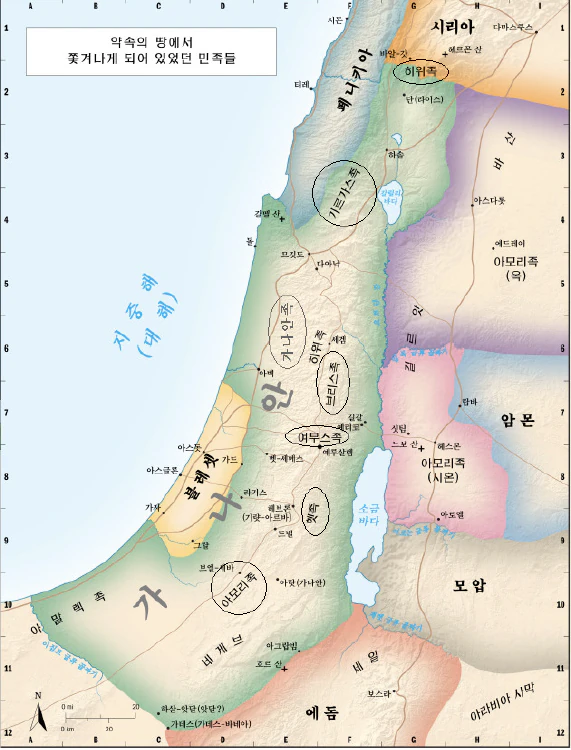
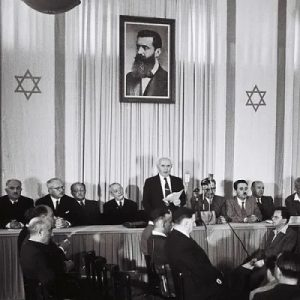
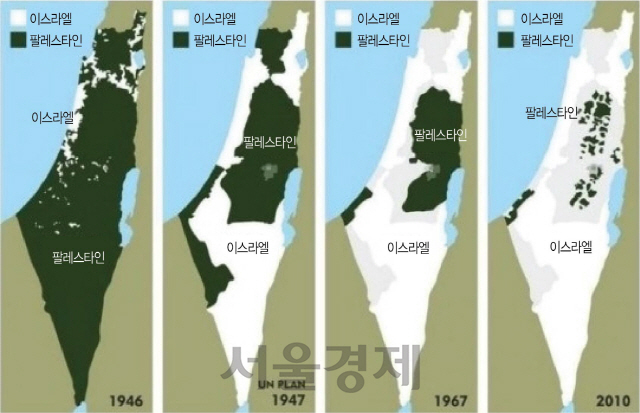
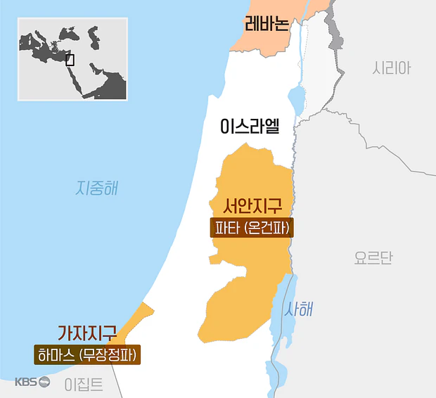
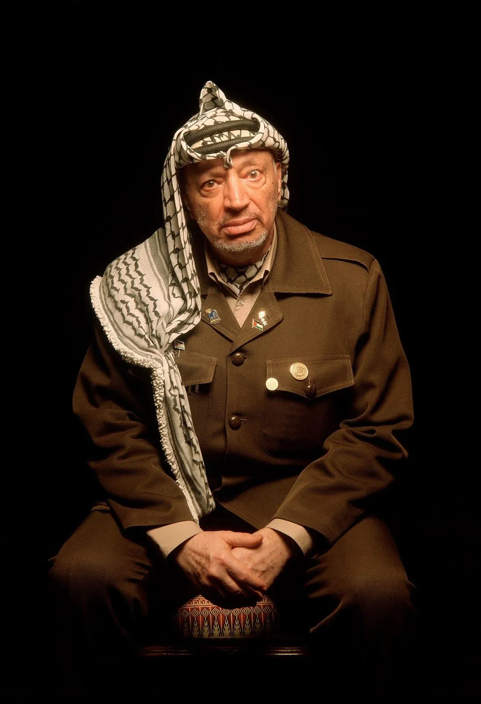
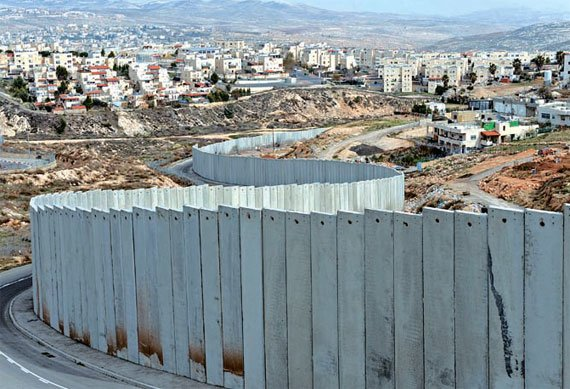

## 1. 유대인의 입장

\- 유대인의 조상인 아브라함이 하나님께 가나안 땅을 약속 받음 (성경 내용). 그게 지금의 이스라엘 지역이고, 예루살렘은 유대인에게 성스러운 곳.

{: width="289" height="380" }
_가나안 땅의 모습 https://biblical-charts.tistory.com/50_

\- 이후에 가나안 인근 지역에서 우여곡절을 겪으며 지냄(기근으로 이집트로 이사를 가기도 하고, 바빌로니아에 의해 멸망당하기도 함)

\- 대부분의 위기들은 극복했지만 결국 로마 제국에 의해서 나라가 없어지고 민족은 학살 당함. (이때 세계 곳곳으로 도망간 유대인이 디아스포라라고 불림)

\- 유대인은 나라 없이 사는 것에 트라우마가 있고, 어떻게든 본인들 입장에서 약속의 땅인 팔레스타인 지방에서 나라를 세우고 살고 싶었음

\- 유대인의 이런 니즈들은 점차 강화됨. 1897년 스위스 바젤에서 유대 국가 건설을 원하는 집단인 시오니스트의 1차 대회가 열렸고, 유대인 국가 건설을 목표로 하는 바젤 강령이 채택됨

{: width="300" height="300" }
_제1차 시오니스트 대회 https://www.bridgesforpeace.com/kr/125%EB%85%84-%EC%A0%84-%EC%98%A4%EB%8A%98-%EC%A0%9C1%EC%B0%A8-%EC%8B%9C%EC%98%A4%EB%8B%88%EC%8A%A4%ED%8A%B8-%EC%9D%98%ED%9A%8C-%EA%B0%9C%EC%B5%9C/_

\- 바젤 강령 이후 1900년대 초, 약 1만 명의 유대인이 팔레스타인에 정착함. 처음에 유대인들과 아랍인들은 서로 충돌 없이 지냈음

\- 근데 영국이 1차 세계 대전 중에 유대인들을 연합국 편으로 끌어들이려고, 팔레스타인 지방에 유대인의 민족적 고향(national home)을 세우는 것을 지지한다고 선언함 (Balfour Declaration. 1917년 아서 밸푸어 영국 외무대신이 발표한 외교 선언)

\- 1차 전쟁이 끝나고 다수의 유대인들이 팔레스타인 땅으로 왔는데 이미 팔레스타인인을 포함한 아랍인들이 살고 있었음. 좁은 땅에 인구가 많아지니 자연스럽게 갈등이 시작됨

\- 1930년대 히틀러의 유대인 박해가 더 심해지자 유대인들이 팔레스타인 땅으로 더 몰려옴. 갈등이 심화됨

\- 2차 전쟁 이후 영국은 이 지역 문제에 발을 빼고 UN에게 SOS를 침. UN은 나름대로 영토를 나누었고 그 영토대로 1948년 5월 14일에 벤 구리온이 이스라엘의 독립을 선포함

\- 우리 땅인데 독립을 한다고? 분개한 주위 아랍 국가들은 전쟁 선언하고 중동 전쟁 발발. 4번에 걸쳐 중동 전쟁이 발발했는데, 전부 이스라엘의 방어/공격이 성공함. 특히 1948년과 1967년 전쟁을 거치며 이스라엘이 차지한 땅(점령지 포함)이 크게 늘어남

{: width="640" height="413" }
_전쟁이 끝날 때마다 좁아지는 팔레스타인 땅 https://www.sedaily.com/NewsView/1VK8Y1NJWZ_

\- 이스라엘은 본인들이 전쟁으로 얻은 지역에 대해서 당당하게 생각함. 하지만 팔레스타인인 입장에서는 갑자기 살 땅이 너무 좁아진 형국

\- 전쟁이 끝난 이후에도 팔레스타인인들 중 특정 무리가 이스라엘에 다양한 위협을 가함. 그래서 팔레스타인 지역 전체를 막아버리는 벽을 설치함

## 2. 팔레스타인인들의 입장

\- 팔레스타인인들은 원래 아랍 지방에서 살고 있었음. 로마에 의해 유대인 다수가 흩어진 이후, 더욱 많은 팔레스타인인들은 팔레스타인 지방에서 지내기 시작함. 그렇게 지낸 것이 2천년 정도 됨(자료마다 주장하는 연도가 다름)

\- 오스만 제국에 의해 팔레스타인도 점령 당했었음. 그런데 제1차 세계대전 중 영국에서 오스만 제국을 상대로 싸워주면 독립을 약속해주겠다고 함 (1915~1916년 맥마흔-후세인 서한)

\- 제1차, 제2차 세계대전이 끝났음. 그런데 갑자기 팔레스타인 지방에 유대인이 엄청나게 늘었음

\- 내 땅에 갑자기 왜 이 사람들이 왔는지 모르겠는데, 영국은 본인은 손을 뗐다고 하고 UN에서는 팔레스타인 영토를 이스라엘과 팔레스타인으로 나눠버림 (1947년 11월29일 결의안 181호)

\- 1948년에 이스라엘이 독립 선언하자 마자 아랍 국가들이 바로 이스라엘 공격 시작. 네번이나 전쟁이 일어났지만 모두 패배했음

\- 결론적으로 갖고 있던 땅은 뺏기고 쪼개져서 가자지구와 서안지구만 남았음

{: width="441" height="403" }
_가자지구와 서안지구. 각각 하마스(무장정파)와 파타(온건파)가 집권 중이다.&amp;nbsp;https://news.kbs.co.kr/news/pc/view/view.do?ncd=7789489_

\- 1957년, 알 파타와 같은 팔레스타인 투쟁 단체가 등장함. 알 파타는 나중에 PLO(팔레스타인 해방기구)에 들어가 최대 분파가 되었고, 그 지도자는 야세르 아라파트

\- 아라파트는 팔레스타인 독립을 위해 싸웠음. 초기에는 테러 행위를 자행함. 하지만 테러 전략이 잘 안먹히자 협상으로 노선을 바꿈

{: width="309" height="452" }
_야세르 아라파트.&amp;nbsp;https://namu.wiki/w/%EC%95%BC%EC%84%B8%EB%A5%B4%20%EC%95%84%EB%9D%BC%ED%8C%8C%ED%8A%B8_

\- 그런데 갑자기 하마스가 등장함. 하마스는 아랍인의 원래 영토 회복을 목표로 하며 유대인과 협상 자체를 거부함

\- 이스라엘이 PLO에 대항하기 위해 하마스를 키웠다는 말이 있음. 이스라엘 예상과 다르게 하마스는 과격한 단체로 성장함

\- 점점 과격해지자 이스라엘은 가자지구와 서안지구 근처에 벽을 세워서 접근을 차단함

{: width="570" height="389" }
_서안지구 장벽&amp;nbsp;https://www.joongang.co.kr/article/19850727_

\- 안그래도 좁은 땅인데 외부로 나가는 길을 다 막아버렸으니 경제 성장이 될 수가 없음. 배고프고 교육은 못 받고, 거주 환경은 안 좋아짐

\- 가자지구와 서안지구 내부에서 이스라엘에 대한 반감은 더 커지고, 테러는 자행되는 악순환 반복. 이럴 때마다 이스라엘은 더 강압적으로 팔레스타인 문제에 대처
